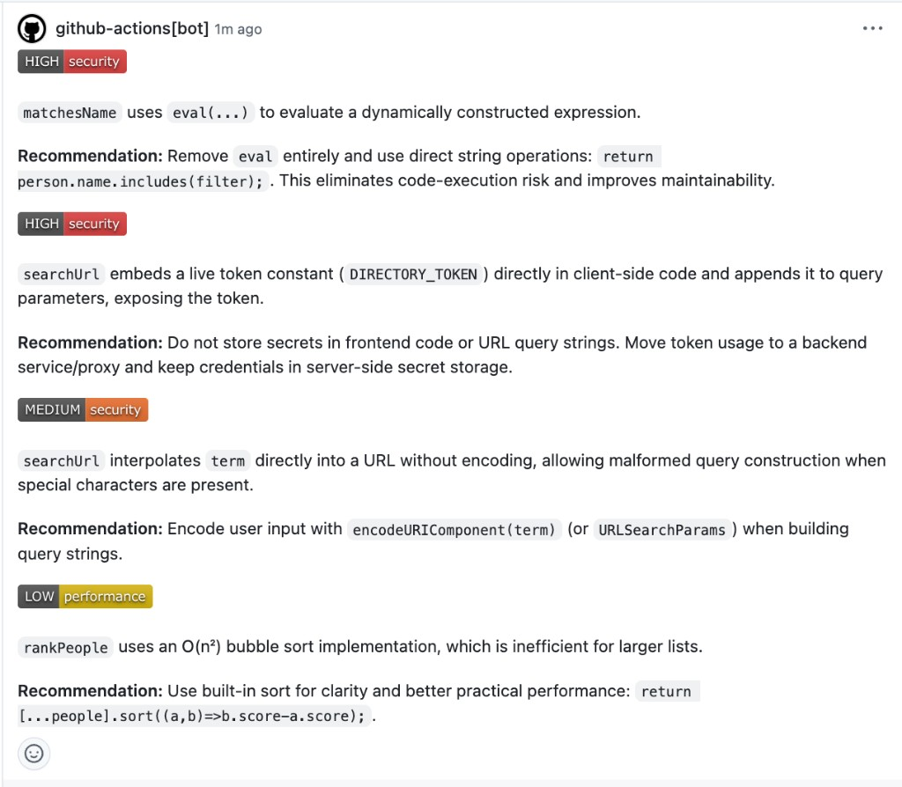

# repo-review

CLI that reviews a GitHub repository in a Vercel Sandbox, runs its tests, and posts a structured AI review on the pull request. Findings use colored severity badges.

## CI/CD

A caller repository runs this review on every pull request by calling the reusable workflow [`.github/workflows/review.yml`](.github/workflows/review.yml). The workflow file has to be on `main` of this repository before another repository can call it.

On each pull request the job:

1. Checks out this CLI from `main` and installs it.
2. Lists the files changed in the caller pull request.
3. Starts a Vercel Sandbox, clones that commit, installs dependencies, and runs the test script.
4. Sends the changed files to `openai/gpt-5.3-codex` and prints the findings in the Action log.
5. Opens one pull request review. Each changed file with findings gets a comment on the first changed line. Severity is a colored badge: red for critical and high, orange for medium, yellow for low.

The caller workflow needs `contents: read` and `pull-requests: write`. Secrets are listed in [docs/credentials.md](docs/credentials.md).

```yaml
name: Code review
on:
  pull_request:

permissions:
  contents: read
  pull-requests: write

jobs:
  review:
    uses: punyprogrammer/cli-code-review-agent/.github/workflows/review.yml@main
    secrets:
      VERCEL_TOKEN: ${{ secrets.VERCEL_TOKEN }}
      VERCEL_TEAM_ID: ${{ secrets.VERCEL_TEAM_ID }}
      VERCEL_PROJECT_ID: ${{ secrets.VERCEL_PROJECT_ID }}
      AI_GATEWAY_API_KEY: ${{ secrets.AI_GATEWAY_API_KEY }}
      REVIEW_BOT_TOKEN: ${{ secrets.REVIEW_BOT_TOKEN }}
```

`REVIEW_BOT_TOKEN` is optional. When it is set to a token for another GitHub account, that account's name is the comment author. Without it, GitHub shows `github-actions[bot]`.



## Local setup

Requires Node.js 22.12 or later.

```bash
pnpm install
vercel link
vercel env pull .env
pnpm review https://github.com/<owner>/<repo>
```

`vercel env pull` writes `VERCEL_OIDC_TOKEN`, which authenticates Sandbox and AI Gateway on your machine. A local run prints the report and does not post pull request comments.

## What the CLI does

`repo-review` takes a public `https://github.com/<owner>/<repo>` URL.

- `sandbox-lifecycle.ts` creates the sandbox, clones the repo, and collects files
- `test-runner.ts` detects pnpm, npm, or yarn and parses test failures
- `analyze.ts` returns a structured review with `generateText` and `Output.object`
- `reporter.ts` prints the severity-sorted report
- `github-review.ts` publishes the pull request review when the Action provides a pull request number

## Tech stack

- [`@vercel/sandbox`](https://vercel.com/docs/sandbox)
- [AI SDK 7](https://ai-sdk.dev/) with AI Gateway (`openai/gpt-5.3-codex`)
- [`commander`](https://github.com/tj/commander.js)
- [`zod`](https://zod.dev/)
- TypeScript 5, `tsx`, `pnpm`
